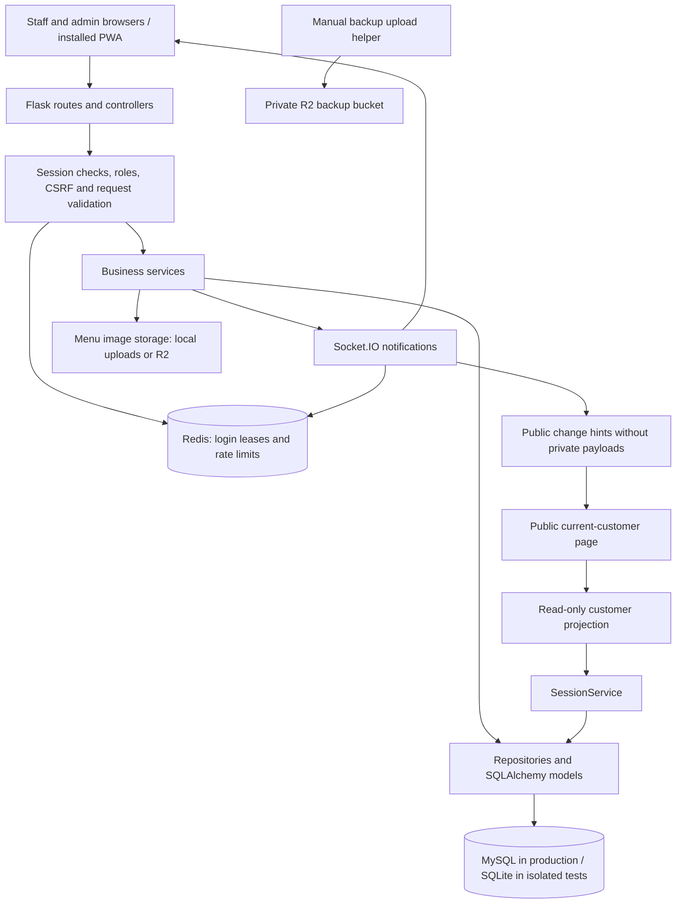

# IdeaFlow codebase map and improvement review

Review date: October 26, 2026.

Status: documentation and investigation only. No application fixes, migrations, GitHub push, or VPS changes were performed for this review.

This maps the local working tree based on `34673e8`, including the uncommitted current-customer page and shared branding work. It describes local source code, not a fresh inspection of the production server. File line numbers below refer to this snapshot and will move as code changes.

## 1. Main conclusions

The application already has useful separation between HTTP routes, business services, repositories, and database models. Its existing test suite covers many important billing, inventory, session, and finance cases. Improvements should build on these parts in small batches.

The highest-priority findings are:

1. Customer names can reach a shared HTML alert renderer without escaping, allowing stored script execution in a signed-in browser.
2. Admin receivable creation confuses an `admins` ID with its corresponding `users` ID, which can reject a valid admin or attribute an action incorrectly.
3. Checkout can commit successfully and then raise an error when broadcasting its notification. The user can see a failure after the checkout is already saved.
4. The management role endpoint accepts a role that the login system cannot authenticate.
5. The ordering menu can display an empty menu when its API actually failed.

These are distinct issues. This review does not establish that any one of them caused every previously reported device problem.

## 2. System overview

For an ordinary business action, the browser sends an HTTP request, the server checks the account, a service applies business rules, and a repository saves the result. Socket.IO tells other browsers to refresh. Database writes and their HTTP result must remain reliable when that notification channel fails.

### Source inventory

Counts exclude images, runtime databases, virtual environments, and `__pycache__`. Lines include comments and blank lines. The documentation count is from before adding this report.

| Area | Source files | Lines | Purpose |
| --- | ---: | ---: | --- |
| `app/` | 178 | 32,500 | Backend, templates, and older bundled static files |
| `static/` | 17 | 3,243 | Active frontend source assets |
| `tests/` | 46 | 9,762 | Test files and shared test setup |
| `config/` | 2 | 282 | Environment-based application configuration |
| `deploy/` | 7 | 795 | Service, Nginx, and setup templates |
| `scripts/` | 4 | 516 | Import checks, admin maintenance, backup upload, bot guard |
| `MD-Folders/` | 55 | 6,812 | Plans, operational guides, and previous reviews |

The Python source contains **207 HTTP route declarations** and **34 declared model tables**. Route declarations are not the number of unique live URLs: some blueprints are registered again under staff prefixes. This count does not include Socket.IO event handlers.

## 3. Where to find things

### Application foundation

| Location | Responsibility |
| --- | --- |
| `app.py` | Local application entry point |
| `wsgi.py` | Production WSGI application entry point |
| `app/__init__.py` | App factory, extension setup, blueprint registration, middleware, error handlers, and public shell routes |
| `config/config.py` | Database, cookies, Redis, rate limits, CSP, uploads, and environment settings |
| `app/utils/auth.py` | HTTP authentication, role checks, session expiry, and lease validation |
| `app/core/session_leases.py` | Redis login lease acquisition, validation, refresh, and release |
| `app/core/idempotency.py` | Duplicate submission protection for requests carrying an idempotency key |
| `app/core/socketio_handlers.py` | Socket authentication, heartbeat, disconnect logging, and domain broadcasts |
| `app/core/notifiers.py` | Notification adapter used by business services |
| `app/core/realtime.py` | Private rooms and compact event payloads |
| `app/core/cache.py` | Cache helpers and fallback behavior |
| `app/core/health.py` | Liveness and database/Redis readiness checks |
| `app/core/observability.py` | Request IDs, response timings, and slow request logging |
| `app/core/bot_defense.py`, `turnstile.py` | Bot controls and optional login challenge validation |
| `app/dto/` | Response and serialization helpers |
| `app/utils/billing.py`, `dates.py`, `payment.py` | Shared billing calculations, Manila date boundaries, and payment method rules |
| `app/utils/inventory_helpers.py`, `uploads.py` | Stock/unit helpers and image upload/storage handling |

The active Flask static directory is the root `static/`, selected by the factory. `app/static/` also contains older files; their existence alone does not establish that they are used.

### Business modules

Paths in the table are relative to `app/` unless they start with `static/`.

| Module | Routes / controllers | Services and repositories | Main user interface |
| --- | --- | --- | --- |
| Login and accounts | `routes/auth_routes.py`, `user_routes.py`, `admin_routes.py` | `services/admin_service.py`, `repositories/admin_repository.py`, auth utilities | Login, profile, `templates/admin.html` |
| Active customers, timed billing, pause/resume, checkout | `routes/session_routes.py`, `dashboard_routes.py`, `receipts.py` | `services/session_service.py`, `repositories/session_repository.py`, `utils/billing.py` | `templates/dashboard.html`, `order.html`, `checkout_records.html`, `receipt.html` |
| Food ordering | `routes/order_routes.py` | `services/order_service.py`, `repositories/order_repository.py` | `templates/menu.html`, `order.html`, food-order screens |
| Menu and recipes | `routes/menu.py`, `staff_menu.py` | `services/menu_service.py`, `menu_availability.py`, `repositories/menu_repository.py` | `templates/admin/menu.html`, `staff/menu.html` |
| Inventory and meal audit | `routes/inventory.py`, `staff_inventory.py` | `services/inventory_service.py`, `stock_management.py`, `meal_daily_audit.py`, `repositories/inventory_repository.py` | `templates/admin/inventory.html`, `static/js/inventory-workflow.js` |
| Boardroom and space bookings | `routes/lounge_routes.py`, `boardroom_routes.py` | `services/booking_service.py`, `repositories/booking_repository.py` | `templates/lounge_booking.html` and booking screens |
| Receivables / customer utang | `routes/receivables.py`, `staff_receivables.py` | `services/receivable_service.py`, `repositories/receivable_repository.py` | `templates/partials/receivables_workspace.html`, `static/js/receivables-dated.js` |
| Payables / supplier and owner debt | `routes/payables.py` | `services/payable_service.py`, `repositories/payable_repository.py` | `templates/admin/payables.html` |
| Expenses | `routes/expenses.py`, `staff_expenses.py` | `services/expense_service.py`, `repositories/expense_repository.py` | Admin and staff expense templates |
| Cash boxes / petty cash | `routes/cash_boxes.py` | `services/cash_box_service.py`, shared sales ledger | Shared modal in `templates/layout.html`, `static/js/cash-boxes.js` |
| Daily Balance, reports, AM/PM balances | `routes/sales_balance.py`, `sales_routes.py` | `services/sales_service.py`, `daily_balance_export_service.py`, `repositories/sales_repository.py` | `templates/admin/daily_balance.html`, report PDF template, Excel/CSV exports |
| Staff Time In/Out and activity | `routes/staff_shifts.py`, `staff_performance.py` | `repositories/staff_repository.py`, `services/staff_performance_service.py` | Staff controls, admin staff history and analytics |
| Additional admin finance, management, analytics | `controllers/finance_controller.py`, `management_controller.py`, `analytics_controller.py`, `routes/analytics.py` | `services/finance_oop_service.py`, `management_oop_service.py`, `analytics_oop_service.py`, `analytics_service.py`, `export_service.py`, `repositories/analytics_repository.py` | Finance, management, and analytics template folders |
| Public running bills | `routes/session_routes.py` | Public projection in `services/session_service.py`, batched query in `repositories/session_repository.py` | `templates/current_customer.html`, `static/js/current-customers.js`, `static/css/current-customers.css` |

### Important route families

- Staff and admin dashboards use protected HTTP endpoints such as `/api/active-sessions` and checkout/order APIs.
- Menu, Inventory, Payables, and Daily Balance have shared blueprints with `/staff/...` aliases. Their route prefixes and decorators both matter when reviewing access.
- Staff receivables use `/receivables-view`; staff expenses use `/expenses-view`.
- `/current-customer` and `/api/current-customers` are intentionally public and read-only. Their data contract must remain separate from private dashboard APIs.
- `/health/live` checks process liveness; `/health/ready` checks required dependencies. Neither replaces a signed-in business workflow test.

### Frontend structure

The UI is server-rendered Jinja with Bootstrap and browser JavaScript. It is not a separate SPA.

- `templates/layout.html` is the main signed-in shell. It includes navigation, shared dialogs, notifications, request helpers, session activity tracking, polling, and realtime setup.
- `templates/auth_layout.html` is the login/authentication shell.
- `templates/partials/brand_head.html` centralizes the shared favicon, fonts, framework styles, and theme stylesheet for the recently updated shells.
- The current-customer page has its own public shell and script; it does not need staff login state to render.
- Root `static/js/` contains focused scripts for cash boxes, dated receivables, inventory, public bills, motion, and PWA installation.
- `static/sw.js` caches an allowlisted installation/offline shell. Business page navigation uses the network, and live APIs are not saved as offline business data.

Several large templates contain substantial inline JavaScript. For example, `admin.html` has 1,461 lines, `layout.html` 1,427, `admin/inventory.html` 1,294, `order.html` 1,236, and `admin/menu.html` 1,090. This increases the chance of duplicate request and rendering behavior.

### Database, maintenance, and deployment

| Location | Responsibility |
| --- | --- |
| `app/db/run_migrations.py` | Main migration/seeding command used during deployment |
| `app/db/migrator.py` | Additive schema/index migration logic |
| `app/db/bootstrap.py`, `seeder.py` | Initialization and seed data, including controlled account provisioning |
| `app/db/inventory_upgrade.py`, `daily_balance_upgrade.py`, `financial_actor_upgrade.py` | Focused data/schema upgrade routines |
| `app/db/reset_demo_data.py`, `reset_operational_data.py` | Explicit destructive maintenance utilities; not ordinary deployment steps |
| `database/run_migration.py`, `app/migrations/run_indexes.py` | Older specialized migration utilities; do not assume they replace the main runner |
| `requirements.txt`, `constraints.txt` | Dependency names and a separately recorded tested version snapshot |
| `.github/workflows/quality-check.yml` | Import validation and isolated pytest run on Python 3.12 |
| `deploy/` | Example service, Socket.IO overrides, Nginx configuration, and setup scripts |
| `scripts/upload_backup_to_r2.py` | Manual upload of one SQL dump and production-files archive to the private backup bucket |
| `scripts/safe_update_admin.py` | Admin maintenance utility |
| `scripts/validate_imports.py` | Import smoke check used in CI |
| `scripts/bot_ddos_guard.py` | Operational bot-defense helper |

Runtime databases, credentials, uploaded media, and local test artifacts are outside this source map. Their contents were not needed for the review.

## 4. Database model map

All 34 declared tables are included below. A declared table is not proof that every legacy UI still uses it.

| Domain | Tables | Purpose |
| --- | --- | --- |
| Accounts | `admins`, `users` | Admin credentials and canonical user rows referenced by business records |
| Customer time and spaces | `customer_sessions`, `session_time_events`, `space_types`, `space_price_history` | Active visits, pause/resume audit, space definitions, price history |
| Bookings | `boardroom_bookings`, `booking_changes`, `lounge_bookings` | Booking state and change history; current BookingService uses BoardroomBooking for its booking workflow |
| Menu | `menu_categories`, `menu_items`, `menu_item_ingredients` | Sellable items, categories, and recipes |
| Stock | `inventory_items`, `inventory_logs`, `order_inventory_allocations`, `inventory_actions` | Quantities, stock changes, per-order allocations, and action audit |
| Orders | `orders`, `order_items` | Customer orders with item/price snapshots |
| Checkout | `transactions`, `checkout_void_requests` | Completed bills and controlled void/refund decisions |
| Receivables | `receivable_tabs`, `receivables`, `receivable_payments` | Customer debt cycles, individual debts, and payment history |
| Payables | `payables`, `payable_payments` | Supplier/owner debts and payments |
| Expenses | `expenses` | Spending, source of funds, actor, and correction/void state |
| Cash tracking | `cash_box_events` | Openings, owner top-ups, withdrawals, and reversal/correction history |
| Daily reporting | `daily_sales_reports`, `soft_balance_entries` | Saved daily and AM/PM snapshots alongside live ledger figures |
| Additional finance | `finance_budgets`, `finance_transactions` | Budget and finance adjustment records |
| Staff | `staff_attendance`, `staff_shifts`, `staff_performance_logs` | Login-related attendance, explicit staff shifts, and activity history |

Removing a ranking display does not justify deleting staff activity or attendance records. Those can still support history and auditing.

## 5. Main data flows and business boundaries

### Login, session continuity, and devices

`auth_routes.py` finds the account, checks credentials, and acquires a Redis lease when single-session enforcement is enabled. An admin also gets a corresponding shadow `User` row so business-record foreign keys can point to `users.id`.

The current login policy allows one staff session and two admin sessions per account. Production enables lease enforcement by default; development and tests can opt out. The configured idle lifetime is one hour. HTTP authorization and heartbeat checks must not keep a genuinely idle account alive indefinitely.

`app/utils/auth.py` checks the session, identity, expiry, and Redis lease. Invalid/expired sessions receive `401` on API paths; registry unavailability has a separate failure path. Socket connect checks authentication again. The disconnect handler at `app/core/socketio_handlers.py:116` logs the disconnect and does not itself release the login lease.

Explicit staff Time In/Out records and authentication sessions are related concepts with different purposes; changing one should not silently rewrite the other.

### Check-in, pause, food orders, and checkout

1. A protected route validates a check-in and creates a `CustomerSession`.
2. Pause/resume affects billable time for Regular/Premium sessions and writes a time event. It does not prevent food orders.
3. An order validates menu availability, saves item/price snapshots, and reserves inventory through the existing stock services.
4. Checkout calculates time and food charges, applies supported checkout adjustments, records a `Transaction`, and completes the visit.
5. Private and public notifications tell browsers to refresh their data.

Billing helpers live in `utils/billing.py`; checkout orchestration lives in `services/session_service.py`. Screens should use those server results instead of independently reproducing charge calculations.

### Receivables and collections

A customer tab groups a debt cycle. Individual receivable records keep their own Date Taken, due date, amount, items, and recorder. Suggestions can include historical customers; a settled cycle can remain in history while a later debt starts another cycle. Payments have their own received-at dates and payment methods, and tab payments apply to unpaid debts through the existing repository logic.

The day a debt is incurred and the day cash is collected are different reporting dates. A collection is not automatically another checkout sale.

### Petty cash, expenses, payables, and Daily Balance

`SalesRepository.daily_ledger()` gathers source records for dated reporting. `SalesService` adds saved report metadata and snapshot differences. `CashBoxService.summaries()` carries balances forward from the opening date and applies each day's movements.

The important distinctions are:

- Checkout sales are Cowork bill + Cafe bill − checkout discounts.
- Sales totals are not the same as physical cash: a checkout may use cash or a digital method, and retained credit needs its own reconciliation.
- Owner money added is a cash transfer into the business, not a sale. Whether it creates owner debt is decided for that entry.
- Cash taken out is a transfer out; spending must be recorded through the appropriate expense/payment workflow.
- Cash refunds and later debt collections use their own event dates. Refund reporting must preserve the supported original-sale history.
- Daily totals follow Asia/Manila dates. A cash balance carries forward; the calendar changing does not itself remove physical cash.
- Hiding a cash card does not remove the underlying ledger or history.

The ledger, method reconciliation, cash boxes, saved snapshots, and exports must agree on these distinctions. This map is not an independent accounting certification or a new full recalculation of production records.

### Public running-bill page

`/api/current-customers` returns an explicit public projection for active timed Regular, Premium, and Boardroom customers. It includes the running time bill, food bill, total, order details, and pause status. It excludes private staff/account fields and checkout adjustments that staff finalize later.

The public Socket.IO namespace receives empty change hints, then the browser fetches the current projection. Visible-page polling provides a fallback when realtime is unavailable. The frontend retains the last successful result during a temporary failure and labels its connection state.

Checked-out or cancelled visits leave the active list. The card grid uses two columns at wider sizes and one on phones; more customers add rows rather than progressively shrinking every card.

## 6. Confirmed findings

Priority definitions: **P1** means address promptly because it affects security or reliable business actions. **P2** means a concrete functional or recovery issue to handle in the next improvement batch.

### F1 — P1: shared alerts interpret customer names as executable HTML

**Locations:** `app/templates/layout.html:636` and `:640`; customer-name caller at `:1298`. The duplicated auth-shell renderer has the same sink at `app/templates/auth_layout.html:250`. Booking input/response paths are `app/services/booking_service.py:32` and `:290`, exposed through protected routes in `app/routes/lounge_routes.py`.

**Trigger and impact:** an authenticated user can save a booking customer name containing markup. The overdue-booking poll puts that stored name into `showToast()`, which concatenates it into `innerHTML`. When another signed-in user receives the alert, an injected event handler can execute in that user's page. The configured policy at `config/config.py:104` permits inline scripts, so it does not block this path.

**Evidence:** the actual shared toast function was extracted and run in a blank, isolated Chrome page using the configured CSP. A harmless marker handler executed. External requests were blocked, and no customer record or production page was modified. The booking input-to-alert path was traced in source.

**Smallest fix:** build the fixed toast structure, then assign its message through `textContent`. Review raw name/description interpolation in `app/templates/menu.html:531` as another rendering surface. Escape values by context or use DOM text/attribute APIs; replacing only single quotes in inline handlers is insufficient. Add a targeted regression for a stored customer name reaching an admin alert.

### F2 — P1: admin receivable creation uses IDs from different account tables

**Locations:** shadow-user creation at `app/routes/auth_routes.py:47`, session assignment at `:190`; receivable route at `app/routes/receivables.py:109` and `:114`; incorrect lookup at `app/services/receivable_service.py:163`.

**Trigger and impact:** login stores the shadow `users.id` in `session['user_id']`. The admin receivable route passes that value with `actor_role='admin'`, so the service searches `admins` using a `users` primary key. The IDs do not have to match. A valid admin can therefore be told to log in again when adding a debt. If that number belongs to another admin, the approval-name snapshot can also identify the wrong person. The receivable's `created_by` foreign key itself targets `users.id`.

**Evidence:** in an in-memory database, an authenticated admin with `admins.id=7` and shadow `users.id=42` received HTTP `400` with “Signed-in account not found. Please log in again.” No receivable was created. The wrong-name case follows from the same lookup but was not separately reproduced.

**Smallest fix:** resolve the actor through the canonical `User` identity stored in the session, with appropriate identity/role validation. Keep business foreign keys pointing to that user row. Add tests where Admin/User IDs differ; tests with both IDs equal to `1` miss this failure.

### F3 — P1: a notification error can turn a saved checkout into an apparent failure

**Locations:** commit at `app/services/session_service.py:597`, notification at `:599`, private emit at `app/core/notifiers.py:16`. The same ordering is present in food ordering at `app/services/order_service.py:146` and `:153`. Idempotency exception cleanup is at `app/core/idempotency.py:86`.

**Trigger and impact:** checkout saves the transaction and completes the visit, then calls a notifier that can raise. A failing Socket.IO/message-queue emit escapes after the database commit. The client receives an error although the checkout is already recorded. Retrying creates uncertainty; this review did not demonstrate a duplicate financial transaction from a second checkout request.

**Evidence:** an isolated checkout with a notifier forced to raise produced an exception while the database contained one saved transaction and a `completed` customer session. Clearing an idempotency reservation on an exception cannot reverse an earlier database commit.

**Smallest fix:** handle post-commit notification failures as best-effort delivery failures, log them, and return the successful business result. Keep validation/database errors visible. Reuse polling/reconnect refresh for recovery. Verify both checkout and order creation with a failed broadcast, rather than introducing a new event infrastructure immediately.

### F4 — P2: management accepts role changes that prevent subsequent login

**Locations:** endpoint at `app/controllers/management_controller.py:46`; accepted roles at `app/models/management.py:9`; assignment at `app/services/management_oop_service.py:36`; login rejection at `app/routes/auth_routes.py:31`.

**Trigger and impact:** the admin management API accepts `manager` and writes it into `User.role`. Login finds that active user but accepts only `staff` in this authentication branch, so the account is no longer recognized. Setting a user's role to `admin` also does not provision an `Admin` credential record through this endpoint.

**Evidence:** changing a disposable staff user to `manager` returned success. Its saved role became `manager`; the real login lookup then returned no account.

**Smallest fix:** restrict this endpoint to roles the authentication system supports, and use the existing controlled admin provisioning path for admin accounts. Keep business job roles separate from authentication roles. Test a fresh login after each supported role change.

### F5 — P2: the ordering menu can present an API failure as an empty menu

**Locations:** `/menu` route at `app/routes/order_routes.py:19`; loader at `app/templates/menu.html:501`; default API `500` body at `app/__init__.py:371`.

**Trigger and impact:** `loadMenuItems()` does not check `response.ok`. A `500` response shaped as `{'error': 'Internal server error'}` has no `success: false`, so it becomes an empty array and the page renders its empty state. The network-error catch also displays the empty state. Users can interpret “could not load” as “there are no items.” This concerns the ordering `/menu` screen; the management menu template is a different loader.

**Evidence:** source tracing of the active route, error handler, and promise chain. This finding was not reproduced on the production site.

**Smallest fix:** use the existing checked JSON helper where applicable, validate the expected response shape, and show separate loading, empty, and failed states. Retain the last good data on transient failures. A `401` should enter the shared clean-login flow, not an empty-data state.

## 7. Practical improvement backlog

These are maintainability or operational opportunities, separate from the reproduced defects above.

| Priority | Improvement | Evidence and smallest useful next step |
| --- | --- | --- |
| Next | Use the same dependency snapshot in CI and deployment | `constraints.txt:1` documents constrained installation, but `.github/workflows/quality-check.yml:29` and `deploy/setup.sh:95` install unconstrained requirements. Apply the agreed constraints consistently and update them deliberately with checks. This is a reproducibility issue, not proof of a vulnerable package. |
| Next | Exercise MySQL-specific financial locking | CI and shared test setup use SQLite. `app/repositories/sales_repository.py:28` switches to MySQL `GET_LOCK` at `:37`, which SQLite tests do not exercise. Add a small MySQL integration job for concurrent funding decisions, transaction boundaries, and migrations. |
| Next | Reconcile the deployment templates with the current installation | `deploy/ideahub.service:23` uses `/var/www/ideahub` and `.venv`; the threaded override at `deploy/phase7-threaded-socketio-override.conf:6` uses `/var/www/pos/venv`. The override changes ExecStart, not every service path. Document one complete deployment layout and validate the effective unit before using these templates. The live unit was not inspected in this review. |
| Next | Make backup recovery demonstrable | The manual helper at `scripts/upload_backup_to_r2.py:52` explicitly checks uploaded byte length at `:53`. Add a backup manifest with checksums and periodically restore a sample into an isolated database. Include a secure configuration/secret recovery procedure separately. Documentation about scheduling is not evidence that a server schedule is active. |
| Next | Give mobile users a useful failure message | Reuse `X-Request-ID` from `app/core/observability.py` in API error displays, with a safe “copy support details” action. Include request path/status/time, not passwords or cookies. Distinguish no data, expired login, denied access, offline, and server failure. |
| Later | Reduce duplicated frontend behavior while touching affected pages | Start with shared toast and checked-request helpers. Move focused page code out of the largest templates when that page changes. Keep the current Jinja/JavaScript approach; a framework rewrite is not required. |
| Later | Audit older assets and parallel entry points | The active static root and `app/static/` overlap, and multiple menu/finance/management paths coexist. Find references before removing files or routes. A file looking old does not prove it is unused. |
| Later | Keep operational documentation current | For example, the actual idle setting is one hour in `config/config.py:186`. Review older session/deployment guidance against code, mark plans as planned/implemented, and give operators a single current release-and-recovery guide. |

Existing useful foundations to preserve include the shared billing helpers, item/price snapshots, inventory allocation history, debt payment history, cash correction history, server-side role checks, isolated test database setup, and the public page's last-good-data recovery behavior.

### Existing test coverage map

These are source areas to reuse when implementing the batches, not a claim that they were all executed in this review.

| Area | Representative existing tests |
| --- | --- |
| Accounts and sessions | `test_session_leases.py`, `test_socketio_authorization.py`, `test_rbac.py`, `test_admin_staff_recovery.py`, `test_client_admin_migration.py` |
| Billing, pause, checkout, refunds | `test_billing.py`, `test_time_pause.py`, `test_checkout_void.py`, `test_cash_change_tracking.py`, `test_mistaken_checkin_cancel.py` |
| Orders and inventory | `test_recipe_inventory.py`, `test_recipe_conversions.py`, `test_order_modifiers.py`, `test_food_only_orders.py`, `test_meal_daily_audit.py` |
| Debts and cash | `test_receivables_dated_tabs.py`, `test_receivable_collection_methods.py`, `test_payable_funding.py`, `test_expense_funding.py`, `test_cash_boxes.py` |
| Reporting and finance | `test_daily_balance_ledger.py`, `test_finance_adjustments.py`, `test_audit_fixes.py` |
| Pages, mobile/PWA, public bills | `test_staff_page_startup.py`, `test_frontend_request_management.py`, `test_pwa_manifest.py`, `test_current_customers.py`, `test_current_customers_frontend.py` |
| Infrastructure and performance | `test_idempotency.py`, `test_infrastructure.py`, `test_phase4_query_efficiency.py`, `test_phase7_threaded_socketio.py`, `test_phase9_deployment_safety.py` |

Test data should deliberately include different IDs for Admin and shadow User records, failed broadcasts after successful commits, hostile display text, and distinguishable HTTP failure states. The current review checks expose gaps that happy-path fixtures can miss.

## 8. Recommended implementation sequence

Each batch should be reviewed and tested independently. No implementation is included in this documentation task.

| Batch | Work | Acceptance checks |
| --- | --- | --- |
| 1 | Fix unsafe alert rendering and admin receivable actor lookup | Stored names render as text; the admin alert cannot execute a supplied handler; admins with different Admin/User IDs can create debts and receive correct attribution; staff creation still works. |
| 2 | Isolate post-commit notification errors and restrict unsupported role changes | A failed broadcast still returns the saved checkout/order result; exactly the intended records exist; supported roles can log in again; unsupported changes are rejected clearly. |
| 3 | Improve data-loading recovery | Simulate `401`, `403`, `500`, offline, reconnect, and slow responses on affected screens. Successful empty responses alone show “no data.” No duplicate writes are caused by retries. |
| 4 | Align release checks and recovery documentation | CI/setup use the same agreed dependency constraints; MySQL checks cover critical locking; service paths are internally consistent; a scratch restore succeeds and its evidence is recorded. |
| 5 | Incremental cleanup | Remove only reference-verified unused files. Consolidate helpers during ordinary feature work and retain the existing behavior/tests. |

For finance-related changes, preserve Manila date boundaries, discount/category reconciliation, original-sale/refund history, receivable collection dates, owner funding versus sales, and cash carryover. Include these invariants in targeted regression checks rather than changing calculations as incidental cleanup.

## 9. Verification record and limits

The review used source inventory/AST inspection, route-to-service-to-model tracing, three disposable in-memory database checks, and one isolated browser check. The local user database and running preview server were not changed by those checks.

| Check | Result |
| --- | --- |
| Admin receivable creation with different Admin/User IDs | Reproduced HTTP `400`; zero records saved |
| Accepted staff-to-manager role change followed by login lookup | Update accepted; subsequent lookup found no account |
| Checkout with a simulated failing notifier | Exception raised after one transaction was saved and the visit became completed |
| Shared toast with supplied markup under configured CSP | Harmless handler executed in isolated Chrome; external requests blocked |
| Ordering menu HTTP error handling | Confirmed by source tracing; no production reproduction |
| Inventory of HTTP declarations and model tables | 207 source declarations; 34 table declarations |

The full pytest suite was not rerun as part of this documentation-only review. Existing tests were inspected to understand coverage. The three checks above used `sqlite://` in a separate process and did not use production credentials. They do not exercise real MySQL concurrency or a production Redis outage.

This is a broad architectural map and a focused review of important execution paths, not proof that every line, device, financial scenario, dependency advisory, or live deployment setting is correct. Physical iPad/Android behavior, the effective VPS configuration, and backup restorability still need their own relevant checks when implementation or release work is authorized.
